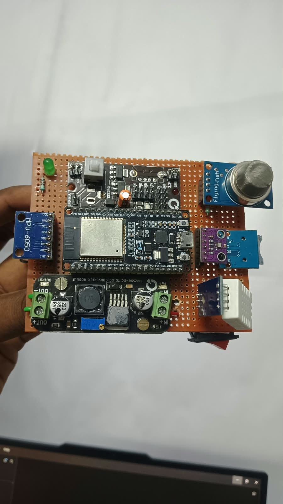

# EDITH

**Environmental Data Intelligence And Tracking Hub** — an ESP32 field station with live environmental readings and a 3D orientation dashboard.



- BMP280 temperature (displayed once) and air pressure
- DHT11 humidity, with missing readings shown as unavailable
- MQ-2 raw readings and smoke indication
- MPU6050 orientation, with compensation for the inverted mounting
- Gentle four-second breathing on the physical GPIO25 LED, independent of sensor faults
- No SD-card dependency

## Source layout

| Folder | Purpose |
| --- | --- |
| `firmware/EDITH` | Main ESP32 Arduino sketch |
| `firmware/diagnostics` | Individual sensor diagnostics |
| `website` | Original complete Cloudflare/Sites website and authenticated D1 receiver |
| `vercel-dashboard` | Native Next.js dashboard ready for Vercel |

The Vercel dashboard reads the existing public receiver at
https://edith-environment-hub.mrltech.chatgpt.site/api/telemetry through its own read-only API route. It does **not** move the database or device ingestion to Vercel. Keep the existing receiver running and leave the ESP32 endpoint unchanged. No device token is required by the Vercel dashboard.

Invalid sensor values stay null. Old samples become offline after eight seconds. Demo mode is explicitly marked and opt-in.

## Run the Vercel dashboard locally

Requires Node.js 22.13 or newer.

```powershell
cd vercel-dashboard
npm ci
npm run dev
```

Open http://localhost:3000. `npm test` checks telemetry validation and receiver behavior; `npm run build` creates the production build.

## Deploy to Vercel

Sign in to the intended **Vercel account**; GitHub CLI login does not choose the Vercel account.

1. In Vercel, choose **Add New → Project** and import `poonkundran021/EDITH`. Authorize the GitHub integration for this repository if prompted.
2. Set **Root Directory** to `vercel-dashboard` and **Framework Preset** to `Next.js`.
3. Use Node.js **22.x**, install command `npm ci`, and build command `npm run build`. Leave the output directory at the framework default.
4. No environment variables are required for the current EDITH receiver. Optionally set the server-only `TELEMETRY_SOURCE_URL` to another compatible public receiver's full `/api/telemetry` URL.
5. Deploy. The board must be powered and connected to Wi-Fi for live readings.

CLI alternative, from `vercel-dashboard`:

```powershell
$edithVercelProfile = Join-Path $env:USERPROFILE '.vercel-edith'
npx vercel@latest login --global-config $edithVercelProfile
npx vercel@latest whoami --global-config $edithVercelProfile
npx vercel@latest link --global-config $edithVercelProfile
npx vercel@latest --prod --global-config $edithVercelProfile
```

The separate global config keeps EDITH's Vercel login separate from your default CLI account. Use the same `--global-config` path for subsequent EDITH Vercel commands. Select the intended account/team during linking and use `./` when asked for the code directory (you are already inside `vercel-dashboard`). Do not reuse another project's `.vercel` directory. GitHub import is the simplest way to enable automatic deployments on later pushes.

## ESP32 upload

Copy `firmware/EDITH/config.example.h` to `config.h` and set your Wi-Fi and private receiver token locally. Never commit that file. The receiver's token is managed separately from this public repository.

```powershell
python -m pip install platformio
cd firmware
Copy-Item EDITH/config.example.h EDITH/config.h
# Edit EDITH/config.h before building.
python -m platformio run -e esp32dev -t upload --upload-port COM5
```

Use your actual serial port if different. If connection fails, hold BOOT, briefly press EN/RESET, retry the upload, and release BOOT once writing starts.

See [SETUP.md](SETUP.md) for pin mapping, calibration and the original Sites deployment. Those hosting/build commands apply to `website`; the Vercel instructions above apply to `vercel-dashboard`.

## Hardware status

The latest physical test before publication received no valid DHT11 humidity in eight fresh samples, while BMP280 and MPU6050 responded. A missing reading does not by itself prove the DHT11 is damaged. Check its power, ground, GPIO4 data connection and exact sensor type.

The MQ-2 is not a certified life-safety alarm. A raw analog value cannot prove that the sensor or its wiring is healthy.
